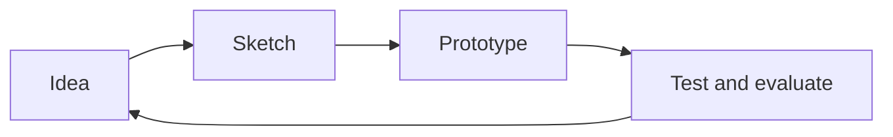

# Circuit palette

Gold traces on solder-mask green — opt in with `themeConfig: { palette: circuit }`

---

# What changes

- Board-green slides with faint gold traces
- Silkscreen text, gold headings rule, LED links
- The gold line fossil for bullets

1. Numbered like solder pads
2. Code sits on the deep board: `palette: circuit`

---

# Diagrams become traces

